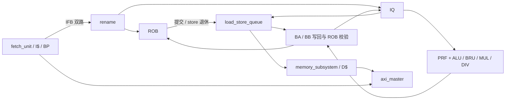

# 架构与代码阅读指南

本设计是双发射、双提交的 RV32IM 乱序 CPU。前端按序取指和译码，后端通过寄存器重命名和动态调度执行指令，ROB 按序提交。提交是架构状态生效的边界；store 的实际 AXI 写入还要等待退休后的 STQ drain。

## 从哪里开始读

1. [`student_top.sv`](../verilog/student_top.sv)：前端、后端、缓存子系统和 AXI 主机的连接及读响应路由。
2. [`cpu_pkg.sv`](../verilog/cpu_pkg.sv)：配置、载荷类型以及统一的 `flush_younger`、`is_uncached` 判定。
3. [`core_ooo.sv`](../verilog/backend/core_ooo.sv)：rename/ROB/IQ/PRF、执行单元、双写回总线和恢复广播。
4. [`rename.sv`](../verilog/backend/rename.sv)、[`rob.sv`](../verilog/backend/rob.sv)、[`iq.sv`](../verilog/backend/iq.sv)：分派原子性、生命周期和发射规则。
5. [`load_store_queue.sv`](../verilog/memory/load_store_queue.sv)、[`memory_subsystem.sv`](../verilog/memory/memory_subsystem.sv)、[`dcache.sv`](../verilog/memory/dcache.sv)：地址生成、顺序约束、缓存与内存事务。

模块类型和文件名按职责命名；`u_core.u_lsu`、`u_lsa`、`u_lsa.u_dc` 等既有实例路径继续保留，方便复用波形定位和综合对照。

## 流水线与时序边界

| 阶段 | 组合工作 | 时钟边沿保存的状态 |
| --- | --- | --- |
| 取指请求 | PC 选择、I$ SRAM 地址 | I$ 请求信息及同步 SRAM 输出 |
| 译码 | I$ 命中判定、双指令译码、预测、前端重定向 | 8 项 IFB |
| 重命名 / 分派 | map/free/busy 查询、同组依赖旁路、资源检查 | rename 映射、ROB 和 IQ 表项 |
| 发射 / 执行 / 写回 | wakeup/select、PRF 读取及旁路、ALU/BRU、结果仲裁 | PRF、ROB done、IQ ready 等 |
| 提交 | 检查 ROB 头部连续完成项，最多提交两条 | ROB head、释放映射、store 退休标记 |

表中是普通 ALU 路径的五个主要阶段。IQ 和 IFB 可以等待多拍；乘法器为 4 级流水线，除法器迭代执行；load/store 另有地址队列、缓存流水线和 AXI 等待。因此“几级流水线”不能代表所有指令的固定完成时间。

`WB_BYPASS=1` 时，写回可以在同一拍唤醒 IQ，并把数据直接旁路到执行输入。不要随意在 wakeup、PRF 或 BRU 之间插入寄存器：这会改变依赖链延迟和 IPC。

BRU 在解析拍通过 `redir_*` 让前端开始恢复取指；`flush_r` 在下一拍向 ROB/IQ/LSQ 广播恢复事件。两条路径分开承担前端低延迟和后端时序收敛。重定向目标与 fall-through 的后继取指地址提前并行计算，避免在 taken 选择后再串联加法器。

## 载荷与命名

| 类型 / 信号 | 含义 |
| --- | --- |
| `decoded_t` | 已译码指令、源/目的架构寄存器和操作类型 |
| `fe2rn_t` | IFB 表项，附带预测信息、BHT 索引和分支序号 |
| `renamed_t` | 分派载荷，含物理源/目的寄存器和 ROB 号 |
| `issue_t` | IQ 发射载荷；操作数值在 `core_ooo` 中读 PRF 后配入 |
| `writeback_t` | 有效位、物理目的寄存器、ROB 号和结果 |
| `mem_req_t` / `mem_resp_t` | LSQ 与缓存子系统之间的请求 / 响应 |
| `RB` / `PB` | ROB 索引位数 / 物理寄存器号位数 |
| `DQ` / `SQ`、`LB` / `SB` | load/store 队列深度及其槽位索引位数 |
| `pdst` / `old_pdst`、`ps1` / `ps2` | 新/旧目的物理寄存器及两个源物理寄存器 |
| `ba` / `bb`、`ba_ok` / `bb_ok` | 原始写回结果及通过 ROB 身份校验的结果 |

`fe_take` 和分派有效位都是双路前缀：slot1 有效意味着 slot0 有效。rename 同拍分配目的寄存器和 ROB 号，同时向 ROB/IQ 原子分派。

## 后端的几个约束

- ROB 对写回同时检查 ROB 号和物理目的寄存器，防止错误路径结果污染已复用的槽位。IQ/PRF 只使用校验后的写回。
- flush 仅杀死分支之后的年轻指令，环形年龄统一调用 `flush_younger`；`dtail` 由 ROB 计算后广播。
- 被杀死且尚未返回的长延迟生产者，其物理寄存器进入 pending 回收状态，等待旧结果返回后再释放。
- IQ 轮转选择最多两条指令，并检查功能单元占用；LSU 候选在符合顺序条件时优先选年龄最老者。
- 同拍发射释放的 IQ 槽位可以接收新分派。旧指令的 wakeup 不能覆盖新表项的 ready 位。
- 写回优先级为 `BA: ALU0 > BRU > DIV`、`BB: LSU > MUL > ALU1`；需保持来源与背压规则配套。

## 访存分层

`load_store_queue` 负责指令生命周期：AGU、4 项 LDQ、16 项 STQ、依赖判定、转发、重试和退休后 drain。`memory_subsystem` 负责事务接入：D$ 实例、store 的缓存/AXI 原子接受、写 tag 表和响应合并。`dcache` 负责缓存流水线、MSHR、refill 和响应 FIFO；`axi_master` 负责外部通道握手与在飞事务标记。

### Load

1. 在 IQ 中，load 不能越过尚未发射的更老 store。进入 LDQ 时，所有更老 store 的地址都已经在 STQ 中。
2. `LOAD_WAIT` 搜索最新的更老重叠 store。完全覆盖且数据已就绪时转发；部分覆盖或数据未就绪时阻塞。
3. 可访问 cache 的候选在 `ld_valid && ld_ready` 时变为 `LOAD_SENT`。MSHR/集合冲突等 replay 将它退回 `LOAD_WAIT`。
4. cache 成功响应以 ROB 号匹配在飞 load，同拍进入 BB；store forwarding 则先进入 `wb_hold_*`，下一拍参与写回。`LOAD_DONE` 保留响应缓冲路径。
5. cache 返回与已保存结果同时出现时，cache 返回优先，hold 继续保存。flush 同时清除年轻的队列表项和待写回转发结果。

同 cache line 的更老 store 还参与 stale-fill 防护。`probe_set_valid` 仅检查集合 valid，是 tag 命中的安全上界；正常 lookup 仍负责完整 tag 检查、MSHR 冲突和 replay。不要将它误读为精确 tag 命中。

### Store

store 按程序顺序发射，但只需要地址操作数就绪。数据可以稍后通过 `ps2` 匹配校验后的 BA/BB 填入 STQ。AGU 完成会标记 ROB done，退休后才允许修改 cache 或发出 AXI 写；错误路径 store 因而无法写入内存。

退休 store 可能比 ROB head 更老，不能只用当前 ROB 环距排序。STQ 使用独立的模退休序号：有 store 退休的周期推进两个 tick，两个提交槽分别用 base/base+1。`SEQW=$clog2(STQ_DEPTH)+2` 确保同时存活 store 的间距小于模域一半；drain、completion 和转发选择采用平衡树及模比较。

对可缓存 store，D$ hit-update 与 AXI write enqueue 必须同拍接受。下一拍的 cache 命中结果与写 tag 一起保存；若 drain 时未命中，则在对应 AXI B 完成时 invalidate，清除竞争 refill 可能留下的旧行。STQ 表项直到 B 完成才释放。

### D$ 与 AXI

D$ 为 1024 行 ×32 B，8 个 32-bit 单端口 word bank，经 fakeram 映射为 32 个 `1024x8` SRAM 宏。端口优先级为 `refill write > load lookup > store update`。tag 读在现有 op/pend 阶段中分成 4 个 bank，缩短大容量 tag mux 路径；live valid 和同拍 fill 旁路仍须参与命中判定。

两个 MSHR 不允许填同一个 set。同一行的字已经返回时可 partial hit，否则可在对应字挂 waiter；只有 waiter 冲突等情况才 replay。trigger、parked waiter、lookup 响应汇入 FIFO；空 FIFO 且只有一项成功响应时可以直通。flush 必须覆盖 lookup 流水线、MSHR waiter 及 FIFO，防止旧响应命中复用后的 ROB 号。

`is_uncached(addr)` 统一定义为 `addr[31:28] != 0`，包括退出 MMIO。非缓存访问仍经过数据访存通路，但不建立有效 cache 行。store 的 AXI 地址按 word 对齐，字节选择由 `wstrb` 表示。

AXI AW/W 独立握手：各自停顿时 payload 保持稳定。两者都完成的周期可装入下一笔；空 write queue 允许直通发送寄存器。B tag 仍按已发出写事务的顺序返回。读响应通过 source/idx 路由至 I$/D$。

## 修改代码时保留的综合结构

- `filelist.f` 同时供正式构建和单元测试使用，新增或重命名模块只改这一处。
- ROB flush mask 使用按常量 tag 位译码。把它缩写成每个 ROB 项的动态大位宽 shift，会显著增加资源分享 SAT 工作量。
- LSU 字节提取和 store 数据移位使用显式 mux，避免再次引入大型动态移位网络。
- SRAM 地址位宽由真实容量决定；D$ 默认配置必须保留全部 10 位 set 地址。综合产物需要检查宏数量和地址驱动，不能只看数字报告。
- 当前宽度是固定双路；`ASSOC=1`。其他参数也受 AXI tag 和 SRAM 宏支持范围约束，不代表任意取值都受支持。

验证方式与已测指标见 [validation.md](validation.md)。
