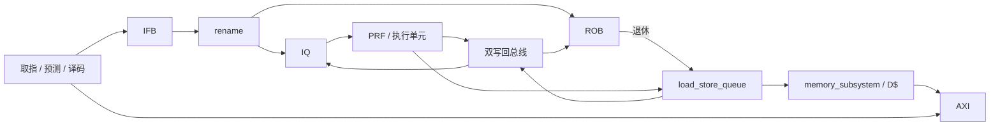

# 架构与代码阅读指南

这是双发射、双提交的 RV32IM 乱序 CPU：前端按序取指和译码，后端重命名并按操作数就绪情况发射，ROB 严格按序提交。store 只有退休后才能修改内存。

默认参数：ISSUE_WIDTH=2、DECODE_WIDTH=2、ROB32、PRF64、IQ8、LDQ8、STQ16；I$ 2 KiB、D$ 16 KiB，32 B cache line、直接映射、2 个 MSHR；BHT128、BTB64；乘法延迟 4 拍，除法迭代执行。开启同拍写回旁路，前端使用寄存后的分支恢复。

## 模块边界

| 模块 | 负责什么 |
| --- | --- |
| `student_top` | 连接前端、后端、缓存与 AXI；仲裁 I$/D$ 读请求，路由读响应 |
| `cpu_pkg` | 硬件参数、模块间载荷类型、ROB 环形年龄和非缓存地址判定 |
| `fetch_unit` / `decode` | PC、预测和双路译码；8 项 IFB；恢复时清空 IFB |
| `icache` / `bp` | 指令缓存；BHT/BTB/RAS 预测与更新 |
| `rename` | 映射表、free/busy/pending 位图、同组依赖和原子分派 |
| `iq` / `prf` | 就绪唤醒和动态发射；4 读口、2 写口物理寄存器堆 |
| `rob` | 写回身份校验、按序提交、恢复映射和物理寄存器回收 |
| `core_ooo` | 后端连接、执行输入旁路、执行单元、写回仲裁和恢复广播 |
| `load_store_queue` | 地址生成、依赖检查、转发、load 重试、store 退休后排空 |
| `memory_subsystem` | D$ 与 AXI 写入的原子接受、store 完成跟踪、响应合并 |
| `dcache` / `axi_master` | 数据缓存、MSHR/refill/响应队列；外部通道握手和请求标记 |

从 `student_top.sv` 和 `cpu_pkg.sv` 开始，再沿 `core_ooo.sv` 或访存通路阅读。实例名 `u_core.u_lsu`、`u_lsa.u_dc` 等保留，便于定位波形。

## 流水线与执行

普通 ALU 指令经过取指请求、译码入 IFB、重命名分派、发射执行写回、提交。IFB/IQ 可以等待多拍，乘除法和访存有各自延迟，因此不存在覆盖所有指令的固定流水级数。

`fe_valid/fe_take` 和双路分派有效位均为前缀：slot1 有效意味着 slot0 有效。有效性由接口信号或队列占用表示，IFB payload 不再重复保存 valid。

rename 只从寄存后的 free_q 分配物理 tag。本拍提交或回收释放的 tag 下一拍参与分配，避免提交/回收组合逻辑直接进入 tag 优先选择器。每路只需要一个 tag：slot0 检查空闲位图，slot1 检查扣除 slot0 分配后的剩余位图，无需统计全部空闲 tag 的数量。pending 隔离及 free/busy/pending 更新规则保留。

`WB_BYPASS=1` 允许写回同拍唤醒 IQ，并将结果旁路至执行输入。IQ 采用轮转优先级，每拍最多发射 ISSUE_WIDTH 条就绪指令；两个 ALU 可并行，其他执行单元各最多接收一条。load 不得越过未发射的更老 store，store 地址按序进入 STQ。

写回优先级固定为 `BA: ALU0 > BRU > DIV`、`BB: LSU > MUL > ALU1`。ALU/BRU 结果寄存器可以在消费旧结果的同拍接收新结果；乘除法由 skid FIFO 吸收背压。DIV/REM 每条指令只有一个请求和一个结果，相同操作数的商/余数缓存继续保留；没有双指令融合协议。

## 提交与恢复

ROB 仅提交 head 开始的连续完成前缀。写回必须匹配有效 ROB 表项、物理目的寄存器和已发射状态。PRF、rename 和 store 数据捕获使用完整校验后的 `ba_ok/bb_ok`。

调度使用 `ba_sched/bb_sched`：寄存生产者提前查 ROB；BB 的 `bb_other` 候选独立于 LSU 有效信号计算。LSU 在 LDQ/转发结果寄存器中保留身份。恢复拍停止分派和发射，架构写回仍执行完整 kill 检查。不要把这些路径合并成先选择 BB 再串行查表的长组合路径。

BRU 解析后，`flush_r` 下一拍恢复 ROB/IQ/LSQ。`EARLY_REDIRECT=1` 可让前端提前一拍取目标；默认关闭，以隔离执行到取指的组合路径。flush 杀死哪些后端表项统一由 ROB 计算环距，再通过 `flush_younger` 判定。

IFB 内所有指令都比已分派的恢复分支年轻，恢复时直接清空整队。已经移除沿 FE/rename/IQ/BRU 传递的分支计数及相应加法器；恢复身份只使用真正需要的 ROB 号和目标 PC。预测仍独立携带取指时的 BHT 索引，用 `up_ix ^ up_pc[GH+1:2]` 重建历史。

被杀死且未返回的长延迟生产者，其物理目的寄存器进入 pending 集合，待旧结果到达后回收。ROB 对每个架构寄存器选择最老被杀写者的 old_pdst 恢复映射；保留并行匹配和优先树，以控制组合路径。

## 访存生命周期

load 只有 WAIT/SENT 两种状态。WAIT 搜索最新的更老重叠 store：完整覆盖且数据就绪则转发，否则阻塞；可访问 D$ 时请求成功后进入 SENT。replay 将其退回 WAIT，成功 cache 响应同拍进入 BB 并释放 LDQ 表项。不存在额外的 LOAD_DONE 数据缓冲路径。

store 转发仍先保存到 `wb_hold_*`，下一拍写回；cache 响应优先于已保存的转发结果，hold 会等待。恢复同时清除年轻队列项和年轻转发结果。

store 可以在数据就绪前计算地址，稍后按物理源 tag 捕获 BA/BB。入队与生产者写回同拍时必须直接捕获数据，即使关闭 WB_BYPASS 也一样。store 退休后才允许 drain，表项保持到 AXI B 完成。

退休 store 可能已经离开 ROB，不能用当前 ROB 环距排序。STQ 用独立模退休序号：存在 store 退休的周期前进两个 tick，两个提交槽分别使用 base/base+1。drain、completion 和转发选择保留模比较。

同 cache line 的更老 store 还参与 stale-fill guard。`probe_set_valid` 只是集合 valid 的上界；D$ 正常 lookup 仍检查 tag、MSHR 冲突和 replay。guard/load 候选采用并行年龄比较，恢复拍暂停新 load 调度，已退休 store 继续 drain。

## Cache 与 AXI

D$ 为 write-through、no-write-allocate；共享 SRAM 端口优先级为 refill write > load lookup > store update。同步 SRAM 输入有寄存器，tag 读在 op/pend 阶段分 bank。每个 MSHR 拥有一个物理 row，同一行支持已返回字的 partial hit 和未返回字的 waiter。flush 覆盖 lookup 流水线、MSHR waiter、响应 FIFO 和同拍新事件，防止旧响应匹配复用的 ROB 号。

cached store 的 D$ 更新与 AXI 入队必须同时接受。下一拍记录 cache hit/miss；未命中 store 在 B 完成时 invalidate，以处理竞争 refill。`is_uncached(addr)` 为 `addr[31:28] != 0`，包括退出 MMIO；store 的 AW 地址按 word 对齐，字节位置由 WSTRB 表示。

访存响应每拍选择一条：AXI B 的 store 完成优先于 D$ load 响应。LSQ 始终接收 store 完成；同拍冲突的 load 留在 D$ FIFO，因此这里无需额外的 store 完成缓冲。

AXI AW/W 独立握手，停顿时分别保持载荷；两路都完成后可同拍装入下一笔。B 按发送顺序返回写 tag。读请求保留 source/idx，响应据此返回 I$/D$。

## 保留的实现约束

- ISSUE_WIDTH 和 DECODE_WIDTH 支持 1/2，ROB/PRF/IQ 容量及 cache 容量/相联度仍真实参数化。ASSOC=1/2；行数表示所有 way 的总行数，SRAM row 为 `{way,set}`，AXI 地址中不包含 way。
- IFB、IQ 指令和写回 FIFO 使用等宽位向量数组。课程原生 Yosys 会误读 package 结构体的非打包数组；不要改回那种写法。审计工具检查实际展开的宽度和深度。
- ROB flush mask 按常量 tag 位译码；字节提取和 store 数据移位用显式 mux；年龄选择用并行比较或平衡树。这些较展开的写法用于控制综合复杂度和关键路径。
- SRAM 继续使用官方 `sram_fakeram`，容量和地址位宽必须一致。默认 D$ 有 32 个 512×8 宏、9 位 row 地址；不能只凭面积数字判断综合正确。
- BP 恢复 PC 使用单次切片 `[GH+1:2]`；连续切片曾导致 RTL/Yosys 连接差异。历史问题见 [known-issues.md](known-issues.md)。

唯一要求来源为 [README-EN.md](../README-EN.md)。复现命令、最新指标及测试边界见 [validation.md](validation.md)，参数敏感性与取舍见 [report.md](report.md)。
